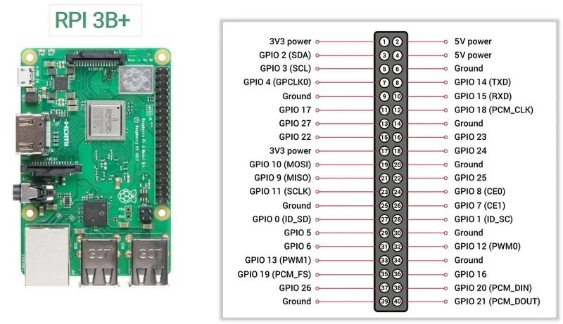
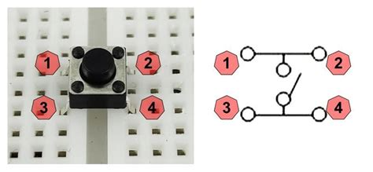

# Raspberry Pi 3B Tutorial: Switching an LED ON and OFF

## Overview

This tutorial introduces GPIO programming on the Raspberry Pi by controlling an LED using Python.



## Learning Objectives

- Understand Raspberry Pi GPIO pins
- Wire an LED safely
- Write a Python program to control an LED
- Create a blinking LED effect

## Hardware Required

| Component | Quantity |
|------------|----------|
| Raspberry Pi 3B | 1 |
| LED | 1 |
| 220Ω Resistor | 1 |
| Breadboard | 1 |
| Jumper Wires | 2–3 |

## Step 1 – Build the Circuit

GPIO17 (Pin 11) → LED → 220Ω Resistor → GND (Pin 6)

## Step 2 – Create the Program

```bash
nano led.py
```

```python
from gpiozero import LED
from time import sleep

led = LED(17)

while True:
    led.on()
    sleep(1)
    led.off()
    sleep(1)
```

## Step 3 – Run the Program

```bash
python3 led.py
```

## Challenge Activities

- Make the LED blink faster.
- Create an SOS signal.
- Build a traffic-light system with three LEDs.

## Troubleshooting

- Check LED orientation.
- Verify GPIO17 is used.
- Ensure GND is connected.
- Confirm the resistor is included.

---

# Activity: Control an LED Using a Push Button

## Learning Objective

In this activity, you will use a push button (switch) as an input device to control an LED connected to a Raspberry Pi.

When the button is pressed:

- The LED turns ON

When the button is released:

- The LED turns OFF

---

## Additional Components Required

| Component | Quantity |
|------------|----------|
| Push Button | 1 |
| 10 kΩ Resistor (optional) | 1 |

> The Raspberry Pi provides built-in pull-up and pull-down resistors, so an external resistor is not required when using GPIO Zero.

---

## Circuit Diagram

### LED Connections

| Raspberry Pi Pin | Connection |
|------------------|------------|
| GPIO17 (Pin 11) | LED Anode (+) |
| GND (Pin 6) | LED Cathode through 220Ω resistor |

### Button Connections

| Raspberry Pi Pin | Connection |
|------------------|------------|
| GPIO18 (Pin 12) | One side of button |
| GND (Pin 14) | Other side of button |

```text
GPIO18 (Pin 12)
      |
   [BUTTON]
      |
    GND

GPIO17 (Pin 11)
      |
     LED
      |
   220Ω
      |
    GND
```

---

## Create the Program

Create a new file:

```bash
nano button_led.py
```

Enter the following code:

```python
from gpiozero import LED, Button
from signal import pause

led = LED(17)
button = Button(18)

button.when_pressed = led.on
button.when_released = led.off

pause()
```

Save the file and exit Nano.

---

## Run the Program

```bash
python3 button_led.py
```

### Expected Behaviour

| Button State | LED State |
|-------------|-----------|
| Pressed | ON |
| Released | OFF |

---

## How It Works

```python
button.when_pressed = led.on
```

This line tells the Raspberry Pi to switch the LED on whenever the button is pressed.

```python
button.when_released = led.off
```

This line tells the Raspberry Pi to switch the LED off whenever the button is released.

---

## Challenge 1 – Toggle the LED

Modify the program so that:

- First press → LED ON
- Second press → LED OFF
- Third press → LED ON

Hint:

```python
led.toggle()
```

---

## Challenge 2 – Count Button Presses

Display the number of times the button has been pressed.

Example output:

```text
Button pressed 1 times
Button pressed 2 times
Button pressed 3 times
```

---

## Challenge 3 – Reaction Timer Game

Extension activity:

1. Wait a random amount of time.
2. Turn on the LED.
3. User presses the button as quickly as possible.
4. Display the reaction time.

Example output:

```text
Reaction time: 0.53 seconds
```

This activity introduces:

- Digital Inputs
- Event-Driven Programming
- GPIO Zero
- Human-Computer Interaction
- Embedded Systems Design

 